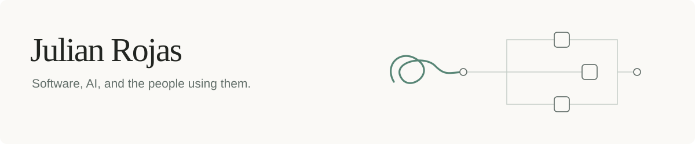

<picture>
  <source media="(prefers-color-scheme: dark)" srcset="assets/header-dark.svg">
  <source media="(prefers-color-scheme: light)" srcset="assets/header-light.svg">
  
</picture>

### I build software around how people think, learn, and work.

I’m Julian, a software builder studying Artificial Intelligence at Tetr College of Business. I work across full-stack development, product design, and AI workflows.

I’m interested in the decisions between a person and a system: what a learner needs next, when an AI suggestion needs human review, and how an interface makes a complicated task feel clear. Building in Dubai and India, and working with teams in Ecuador, has taught me to question which assumptions travel well across cultures.

[Portfolio ↗](https://julian-rojas.vercel.app/) · [LinkedIn](https://www.linkedin.com/in/julianrojas-s/) · [X](https://x.com/julianro1011)

### Selected work

**[Lydo](https://lydoo-learning-demo.vercel.app/)** · Adaptive math tutoring  
Co-built a tutor using learner profiles and uploaded materials. Led product design and contributed to its RAG pipeline. The link shows the landing demo.

**[Napkin](https://www.usenapkin.com/)** · Feedback into product decisions  
Designed the product and co-designed agent workflows that turn customer feedback into specifications and prioritized tasks, with a person reviewing the output. Delivered tailored implementations for businesses.

**[Alltex](https://julian-rojas.vercel.app/portfolio/)** · Production workflows  
Reworked production processes with the team and independently built the full-stack system, from customer inquiry to warehouse dispatch, including the database and role-based access.

*Napkin and Alltex are commercial work; their source code is private.*

### Code you can explore

- **[StudyMate](https://github.com/julianrojas1011/studymate)** — A terminal study assistant with retrieval over lecture notes, persistent memory, and an MCP interface.
- **[QuizForge](https://github.com/julianrojas1011/QuizForge)** — A terminal study tool with open-ended quizzes, adaptive difficulty, and study plans.

Working with Python, TypeScript, React, Supabase, and Figma. Always interested in comparing notes on learning, human–AI interaction, and thoughtful software.
